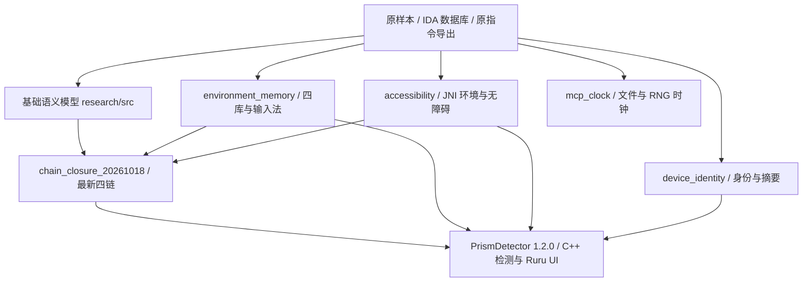

# 源码架构与阅读顺序

原样本 `libprism-sun.so` 提供静态逆向依据；`01_source/research` 是 C++17 语义重建，`07_application` 是使用部分重建能力的独立 Android 检测应用。反编译 `.c` 在证据目录，不能当作可编译的重建源码。

四链模块复用 `environment_memory/src/environment_memory.*`、`src/observed_models.*` 与 `accessibility/src/accessibility_env.*`。这些目录之间的相对位置保持原样；每个模块的 `src`、`tests`、`scripts` 仍在一起。

`research/aggregate` 及 `build_all_detections.ps1` 是历史聚合工程，其已存 SO 没有纳入新四链源码。最新四链产物为 `04_binaries/research/chain_closure_20261018/build/android-arm64/libprism_chains.so`。两者都不是原插件的 ABI 替代品。

先读 [当前状态](CURRENT_STATUS.zh-CN.md)，再读 [模块对照](MODULE_MAP.zh-CN.md)，随后阅读相应报告、源码和证据。完整文件树在 [TREE.txt](TREE.txt)，旧路径到归档位置在 [FILE_INDEX.csv](FILE_INDEX.csv)。
