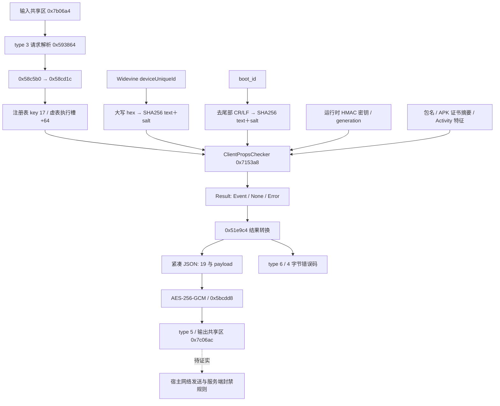

> 归档阅读副本：只调整文件超链接；原文、代码块中的历史路径与结论保持原样。[逐字节原始文件](../../../03_evidence/original_documents/research/device_identity/REPORT.zh-CN.md)。历史失效链接转到文件索引，原目标见 `00_guide/report-link-audit.json`。

# PrismSUN 设备身份链路逆向报告

研究日期：2026-10-15。目标：`D:\PrismSUN\libprism-sun.so`，Android AArch64 ELF，image base 为 0，文件大小 8,030,488 字节。SHA-256：

```text
92e7d4adda7e222aa9dce389009a186adabb2602b80d618d417e0f6d509adaf4
```

## 1. 核心结论与研究边界

本样本的 `ClientPropsChecker` 优先读取 Widevine MediaDrm 的 `deviceUniqueId`，将原始字节转成大写十六进制文本，再附加固定的 16 字节盐计算 SHA-256。主来源失败或为空时，改用 `/proc/sys/kernel/random/boot_id` 的内容进行同样的加盐摘要。最终设备 ID 是 64 个大写十六进制字符；两个来源都失败时，设备字段可以为空。

该设备字段与输入字符串、客户端版本一起，用运行时会话 HMAC 密钥生成 HMAC-SHA256。事件 19 同时包含应用包名、APK v2 首个签名者的首张证书摘要和两个 Activity 特征。事件经过紧凑 JSON 序列化和 AES-256-GCM 封装，以 type 5 记录交给输出共享环形缓冲区。

已闭合的范围是**本 SO 内的设备来源、派生、事件认证、加密和共享区交付**。宿主程序如何消费该共享区、如何通过网络发送，以及服务端如何将该字段关联到封禁规则，仍未获得证据。本目录未提供匹配宿主 APK、真实抓包、Android 设备或服务端代码，因此不能把共享区交付写成已经观测到的服务端上传，也不能声称已完整逆向设备封禁系统。

`boot_id` 标识一次系统启动，会随重启变化。Widevine 返回值在具体 Android 版本、应用和设备上的稳定性未进行真机实验。这条路径能够说明客户端提交的身份材料，不能单凭静态代码保证永久、全局唯一的硬件身份。在已追踪的事件 19 路径中，未发现将 IMEI、网卡 MAC、Android ID 或硬件序列号混合到设备摘要的步骤；此结论的搜索边界是该事件路径，不能扩展为整个 SO 从不读取这些信息。

## 2. 证据方法

本研究使用 IDA Pro MCP 分析副本、REA 静态 dossier、原 ELF 按 FDE 边界导出的 ARM64 汇编，以及 Unicorn 有界指令仿真。C++ 重建结果与独立 Python `hashlib`、`hmac`、`cryptography.AESGCM` oracle 和保存的原指令结果比较。

证据分为四类：

| 类别 | 含义 | 限制 |
| --- | --- | --- |
| 原件静态证据 | 原 ELF 字节、汇编、交叉引用、虚表和字段访问 | 没有观测真实运行环境 |
| 原指令仿真 | 在合成内存、合成平台返回值下执行原件指令 | 平台采集、libc、TLS、部分对象操作等有显式模型边界 |
| 工程重建 | 可编译 C++17 和 Android 适配层 | 包含资源管理、边界检查等有意差异 |
| 未知 | 当前证据不足以证明 | 不用猜测补齐 |

仿真执行的是映射到内存的原 ARM64 指令，不启动目标应用或原 SO 的宿主进程。未知导入与非白名单系统调用受到阻断。JNI、MediaDrm、文件 I/O、熵来源和分配器等由固定测试输入提供；密码算法主体使用原指令并与独立实现比较。`modeled_boundaries` 字段记录每个实验的替代边界。不能将这些实验描述成 Android 真机实测。

IDA 的 `auto_analysis_ready=false`，数据库不代表整个模块已分析完毕。混淆导致部分 Hex-Rays 输出存在 bad-SP、JUMPOUT、寄存器和类型恢复错误。本报告对关键行为优先采用原汇编和有界执行，而不是逐行照抄伪代码。新数据库保存了 17 处业务命名和 5 处说明注释，详见 `evidence/ida-annotations.json`；FDE 恢复请求的 54 个函数均报告已存在，不能算成新建成功。

## 3. 请求到输出的链路



注册初始化 `0x6fe530` 将工厂回调注册到 key 17。回调虚表是 `0x793f68`，invoke 是 `0x70294c`；工厂构造的 checker 虚表是 `0x793fb0`，其 +64 执行槽指向 `0x7153a8`。`0x7144a0` 返回名称 `ClientPropsChecker`，`0x7149d8` 返回任务 ID 17。**任务 ID 17 和输出事件号 19 属于不同层。**注册与工厂由原指令实验验证，注册表查询/插入边界由模型提供，见 `registration-original.json`。

## 4. 设备来源和派生公式

固定盐是二进制字节，不是下列文本的 ASCII 编码：

```text
67 d6 d3 1d ce a9 ee c7 ba 1b 1c e2 c8 7b ab 7b
```

### 4.1 主来源：Widevine

`0x5a7be4` 动态加载 `libmediandk.so`，解析 `AMediaDrm_createByUUID`、`AMediaDrm_getPropertyByteArray`、`AMediaDrm_release`。`0x5ae1d4` 在加载器可用且 context+217 的 disabled 字节为 false 时，用 Widevine UUID 查询属性：

```text
UUID: ed ef 8b a9 79 d6 4a ce a3 c8 27 dc d5 1d 21 ed
property: deviceUniqueId
```

原始字节先编码成大写 hex；`0x4df3c8` 再调用 `0x5b9df4` 计算摘要：

```text
source_text = HEX_UPPER(deviceUniqueId_bytes)
device_id   = HEX_UPPER(SHA256(ASCII(source_text) || salt_bytes))
```

例如合成原始输入 `00 01 FE FF` 先变成 ASCII 文本 `0001FEFF`，然后附加盐。直接对 `00 01 FE FF || salt` 做摘要会得到不同结果。加载、创建或读取失败，以及空属性，导致主来源返回空字符串，触发备用来源。采集入口为空时直接返回空字符串，**不生成空内容加盐的 ID**；底层摘要 helper 本身仍能计算空数据加盐。

原件成功路径释放 MediaDrm 对象；属性读取失败路径缺少 release。C++ 适配层使用资源管理修复该失败路径泄漏，此差异不改变已验证的返回值语义。

### 4.2 备用来源：boot_id

`0x4dfc3c → 0x5d8330` 打开 `/proc/sys/kernel/random/boot_id`，最多读取 47 字节，关闭打开的文件描述符；文本在首个 NUL 截断，然后删除末尾所有 CR/LF：

```text
source_text = trim_trailing_CR_LF(C_string(first_47_bytes(read_result)))
device_id   = HEX_UPPER(SHA256(source_text_bytes || salt_bytes))
```

open/read 失败或规范化后为空时返回空串。Hex-Rays 曾将关闭参数恢复成 read 返回值，原汇编与仿真确认实际关闭的是文件描述符。此处不是永久设备号。固定盐在 SO 中可恢复，作用是确定性派生/域区分数据，不能视为会话秘密。

13 个采集场景覆盖主来源可用、disabled、失败、空结果，以及备用来源的读取、NUL、长度和尾部换行行为，详见 `collectors-original.json`。

## 5. 事件 19、输入校验和 HMAC

`0x7153a8` 接受的参数根节点必须是 JSON 数组，数组中恰好有一个字符串。对象根节点、0/2 个条目或非字符串条目返回 None。输入字符串按 C 字符串语义在首个 NUL 截断，截断后的长度至少为 8 **字节**；这不等于 8 个 Unicode 字符。

输入满足条件后，选择主 ID；主 ID 为空则选择备用 ID。选择主来源时第二个设备字段为 true，回退时为 false。主、备用都为空仍允许继续。context+616 的 generation 为 0 时返回错误 6005；准备状态通过后读取运行时 HMAC 密钥并计算：

```text
version = "PSR_20260211.5223e3a"
message = device_id_text || input_string || version
mac     = HEX_UPPER(HMAC_SHA256(context_hmac_key_bytes, message_bytes))
```

拼接没有分隔符。本文将输入字符串命名为 `challenge` 便于说明；当前没有真实请求或抓包证明它一定是服务端 nonce，不能把这个命名当成协议事实。`0x5ba370` 的密钥参数是 byte vector，不是 libc++ string；有效 HMAC 原指令对照见 `hmac-original.json`。

JNI 上下文不可用时返回错误 3002。generation=0 且 JNI 同时不可用时，6005 优先。正常结果使用 `0x634e84` 构造 kind 0、event 19，payload 形状如下。以下 TEST 值全部是合成输入：

```json
[
  ["PSR_20260211.5223e3a", 1],
  ["DEVICE_ID", true],
  ["CHALLENGE", "F58A99D1DB371A5BFA267DE55BBF19A24FA143582A34B11B51E855EFA9102F03"],
  ["APP_PACKAGE", "TEST_APK_DIGEST", "TARGET_ACTIVITY", true]
]
```

第一行的整数 1 已确认存在，其协议语义尚未由宿主/服务端证明。最后一行的第三项实际是下面描述的微信 Activity 名称前缀，不是“当前 Activity”。

| Result 偏移 | 字段 |
| --- | --- |
| +0 | u32 kind：0=Event、1=None、2=Error |
| +4 | u8 event；本路径为 19 |
| +8 | cJSON 指针 |
| +16 | u32 error |

对象大小为 24 字节。保存的事件实验检查了对象后 16 字节保护区。6 个基础场景及 9 个输入边界场景均从原入口返回，见 `event-original.json`、`event-boundaries-original.json`。数组 shape 的拒绝由原件 fixture 检查；C++ 公共接口使用类型化的 vector 参数，不包含完整任意 JSON 根节点解析器。

## 6. 应用属性不是设备来源

### 6.1 包名和 Activity 特征

包名来自 JNI 的 `getPackageName()`。`0x37fb88` 调用 `getPackageManager()` 与 `getPackageInfo(getPackageName(), 1)`，其中 1 对应 GET_ACTIVITIES，然后遍历 `PackageInfo.activities[].name`。

对以 `.wxapi.WXEntryActivity` 结尾的名称，取第一处该子串之前的前缀；遍历中后一个匹配项覆盖前一个结果。`a.wxapi.WXEntryActivity.extra` 不匹配。另一个 bool 表示是否出现精确名称 `com.netease.mpay.MpayLoginActionBarActivity`，带额外后缀不匹配。

这两个字段反映应用中声明的 Activity，不能解释为前台 Activity、主 Activity 或硬件指纹。7 个 JNI 表仿真场景见 `activity-original.json`。

### 6.2 APK v2 第一证书摘要

`0x37843c` 从 JNI 取得 `ApplicationInfo.sourceDir`，执行路径、open、stat 和大小检查，再调用 `0x4c0718` 提取证书，最后经 `0x3780ec` 计算不带设备盐的 SHA-256：

```text
EOCD → central directory offset → APK Sig Block 42
→ pair ID 0x7109871a（APK signature scheme v2）
→ 第一个 signer → signedData → 跳过 digests 序列
→ certificates 序列中的第一张证书
→ HEX_UPPER(SHA256(certificate_bytes))
```

这不是整个 APK 文件的摘要，也没有证明执行证书信任或 APK 签名验证。仅有 v1/v3 的 APK 不由这条 v2 提取路径覆盖。

| 条件 | 字段返回值 |
| --- | --- |
| sourceDir 为空 | `FAIL_1` |
| 路径不以 `/data/app/` 开头 | `FAIL_2` |
| 打开失败 | `FAIL_3` |
| stat 失败 | `FAIL_4` |
| 文件大小小于 0x40000000，即 1 GiB | `FAIL_5` |
| 未提取到证书 | `FAIL_6` |

**1 GiB 是原样本的最低大小门槛。**汇编和合成 stat 实验确认了比较方向，不能自行“修正”为最大大小限制。低于门槛的应用将在该字段给出 `FAIL_5`，不进入后续证书提取。为何设置此门槛、真实宿主是否达到门槛，当前未知。

`apk-wrapper-original.json` 有 5 个路径/大小场景，其中成功场景的证书提取边界被替换；它不是真实 1 GiB APK 的实测。`apk-original.json` 则对合成 ZIP/APK v2 数据执行原提取与摘要，含 ZIP comment 场景。错误标记来自静态分支；open/stat 失败并非这 5 个实验都覆盖。C++ parser 增加嵌套长度和截断检查；Android adapter 只 pread 尾部和签名块，并限制签名块不超过 64 MiB，避免把大文件整体载入内存。

## 7. 会话密钥与计数状态

| context 偏移 | 类型和用途 | 相关函数 |
| --- | --- | --- |
| +568 | AES 密钥 byte vector | getter `0x59417c` |
| +592 | HMAC 密钥 byte vector | getter `0x71ab84` |
| +616 | u16 generation；非零表示 ready | `0x4d92b4`、`0x4d1f14` |
| +624 | u64 next_sequence | `0x596b58` 返回旧值再加一 |

`0x5b77d8(context, keyA, keyB, generation)` 分别复制两个 vector，写入 generation，并将 sequence 清零。`session-original.json` 的三个原指令场景确认了安装布局、ready、generation 和第一次 sequence 读取。

静态上游沿输入 ring type 8 进入 `0x4cb88c → 0x56d7fc → 0x56eae4`；解析成功后用两个 vector 调用安装器，generation 在原值基础上加一，生成 type 9 响应。`0x56eae4` 的完整握手解析/密钥协商尚未重建；其完整 FDE 汇编已保存，但反编译存在 JUMPOUT。因此只能确定 HMAC/AES 使用运行时安装的状态，不能断言密钥是固定硬编码、永久设备 secret，或已恢复服务端协商协议。

原安装器自身允许 generation=0 或非 32 字节 AES key。C++ `Session::install` 要求 generation 非零且 AES key 为 32 字节，是工程入口检查，不能声称该检查来自原安装器。

## 8. AES-GCM 封装与结果交付

正常结果沿 `0x51e9c4 → 0x5959c8 → 0x596028`，先生成紧凑 JSON：

```text
plaintext = UTF8("[19," + payload_json + "]")
nonce     = 00 00 || generation_BE16 || sequence_BE64
cipher    = AES_256_GCM(aes_key, nonce, plaintext, AAD=empty)
packet    = ((random_nibble << 4) | 2)
            || generation_BE16 || nonce_12 || ciphertext || tag_16
```

`0x5bcdd8` 使用 AES-256-GCM，nonce 为 12 字节，认证标签为 16 字节，没有额外 AAD。generation 同时出现在前缀和 nonce 中。首字节高四位来自范围 0..15 的随机值，低四位为 2；当前未证明高四位的服务端用途。测试把随机值固定为合成 nibble。

| packet 偏移 | 长度 | 内容 |
| --- | ---: | --- |
| 0 | 1 | 高四位随机值，低四位 2 |
| 1 | 2 | generation，大端 |
| 3 | 12 | nonce：两个 0、generation、sequence |
| 15 | 明文长度 | ciphertext |
| 15+明文长度 | 16 | GCM tag |

总长度为明文长度加 31。`packet-original.json` 中空明文、3 字节和 65 字节明文的原指令输出与独立 AESGCM 逐字节一致。

`pipeline-original.json` 在合成设备/应用输入和密钥下串接原事件入口、结果转换、JSON/加密和 ring 写入入口。generation=0x1234、sequence=7，随后 sequence 为 8；得到 221 字节 packet、type 5 记录。`output-ring.bin` 保存完整输出区，并与 C++ 输出逐字节比较。上游请求解析/全部调度器、真实平台采集和真实宿主消费没有在该 fixture 中整体执行。

Result 的三种输出行为为：Event 转为 type 5；None 不生成记录；Error 转为 type 6，载荷为 4 字节小端错误码。type 6 不经过上述事件加密流程。结果送入输出区的静态链路为 `0x56b96c → 0x4ce0f4 → 0x591b70 → 0x58fac8`。

## 9. 共享 ring 与尚未解释的多槽行为

输入区为 `0x7b06a4`，由 `getSharedMemory` 暴露；输出区为 `0x7c06ac`，两区相差 0x10008。单区布局为：

| 位置 | 字段 |
| --- | --- |
| ring+0 | u32 writer |
| ring+4 | u32 reader |
| ring+8 | 16 个 4096 字节槽 |
| 首槽+0 | u32 总长度 |
| 首槽+4 | u8 type |
| 首槽+5 | u8 槽数 |
| 每槽+6 | u16 长度 |
| 每槽+8 | payload；协议每槽容量 4088 字节 |

既有研究已验证 reader 的 32 位回绕和分段读取模型。本次 writer 的 9 个场景覆盖空载荷、单槽、满队列拒绝、过长拒绝和 u32 writer 回绕。空记录也占一个槽。单槽及所测试拒绝分支与 C++ 差分一致。

多槽成功场景在原文件内存映射 fixture 中有异常：4089 字节时首槽 length=4089，续槽头和数据为 0；65408 字节时首槽 length=65408、count=16，续槽为 0。写入器 `0x590650..0x590664` 的 min 计算引用 `0x3dc58` 常量，原文件字节为 `8a059266268680be`，位于 `.rodata`，没有 relocation，保存的 xrefs 仅指向写入器相关位置。

目前未找到并证明该常量的初始化/解码，**不能断言已找到异常根因，也不能推断真实应用必然具有相同异常**。C++ `Ring` 按协议容量 4088 字节分片，是可用的单线程内存工程模型。最终 verifier 显式排除两个多槽成功场景，不声称这部分与原 writer 等价。Windows argv 过长的场景没有走 CLI 差分；C++ unit 覆盖过长拒绝。

`Ring` 不提供跨进程原子、并发或 producer/consumer 内存序等价保证。研究和 C++ 适配层均未创建额外线程；Android JNI 由调用者传入已经有效的当前 `JNIEnv*`，不自行 attach 线程。

## 10. 可编译重建及有意差异

| 文件 | 作用 |
| --- | --- |
| `src/identity.hpp`、`src/identity.cpp` | 设备派生、输入规则、事件、会话、packet 和单线程 ring 模型 |
| `src/crypto.cpp` | 自包含 SHA-256、HMAC-SHA256、AES-256-GCM |
| `src/android_adapter.hpp`、`src/android_adapter.cpp` | MediaDrm、boot_id、JNI 应用属性采集 |
| `src/main.cpp` | 合成 demo 与差分测试 CLI |
| `tests/unit_tests.cpp`、`tests/verify.py` | 工程边界测试、独立 oracle 与保存的原指令对照 |

本重建是研究用 C++ API，未恢复原插件完整 ABI、对象布局、导出接口、握手或网络协议。Android 共享库由 C++ 调用者链接使用；没有提供完整宿主 Java 集成入口。

有意差异包括：失败路径释放 MediaDrm、RAII 文件/JNI 引用管理、严格 APK 长度检查与 64 MiB 签名块上限、会话入口拒绝零 generation/非 32 字节 AES key，以及 sequence 到达最大值前抛出异常，避免继续使用回绕 nonce。原 sequence 函数使用无符号递增。APK/JNI 的异常统一映射也是工程处理，不宣称每种异常路径都与原件逐项相同。随机 nibble 由 API 调用者提供，本重建没有恢复原熵生成器。ring 多槽分片属于上一节说明的工程模型。

## 11. 构建与验证结果

`scripts/build.ps1` 已实际构建 Windows 宿主 executable/unit_tests、Android arm64 executable 和 shared library。编译选项为 C++17、O2、Wall、Wextra、Werror；NDK 27.0.12077973，目标 `aarch64-linux-android24`。Android 产物使用静态 C++ 运行库；共享库链接 dl。Android 仅完成交叉编译，未真机加载或运行。

最终 `evidence/verification.json` 状态 PASS，共 **117 项检查**：

| 分组 | 检查数 | 比较范围 |
| --- | ---: | --- |
| 独立 SHA/HMAC/AESGCM oracle | 37 | C++ 输出与 Python 独立实现 |
| 原设备采集入口 | 13 | 保存的原入口结果与 C++ 派生 |
| 原 HMAC | 3 | 原指令与 C++ |
| 事件及输入边界 | 23 | kind、payload、error；含原件 shape 拒绝检查 |
| 原会话布局 | 3 | 原安装器/getter 结果与合成输入；不是 C++ setter 全差分 |
| Activity | 7 | 原 JNI 表 fixture 与 C++ 特征规则 |
| APK | 10 | 第一证书、摘要、工程截断拒绝 |
| 原 packet | 3 | packet 逐字节 |
| 串接 pipeline | 3 | packet 和完整单槽输出区 |
| ring | 12 | 6 个可比较场景的返回值/内存 |
| C++ unit | 1 | 程序退出成功，内部覆盖参数、转义、顺序、非法 key/APK 等 |
| 注册与执行槽 | 2 | 保存的原指令注册结果 |

117 是断言/check 数，不是 117 次真实 Android 或服务端端到端运行。APK wrapper 的 5 个实验是另行保存的证据，不额外计入 117。详细复现说明见 `README.md`。

历史 `digests-original.json` 含早期密钥 ABI 错误造成的 HMAC 失败，不能整体算 PASS；有效 HMAC 文件为 `hmac-original.json`。`rea-session-install.json` 是 unreadable_output 错误记录，不能当作成功 dossier。这些历史记录保留以便审核，不覆盖最终有效结果。

## 12. REA 证据和问题完成度

`evidence/rea-evidence.json` 保留三份成功静态 dossier：

| 地址 | Evidence ID |
| --- | --- |
| 0x4df3c8 | `ev_87d6004c70c4f839302e89671e070505bd093bf65d64e31b0fd27a880e0d230d` |
| 0x5b9df4 | `ev_4b56a0c430a3a1ae51898e13a35065b4432f446c710589bfb42eebcc6ac79322` |
| 0x7153a8 | `ev_a83b9fd8e38ae9c3e93ec5fa4063d070699e5dd245b4aa9051f30f712c36fe51` |

`evidence/rea-final-evidence.json` 仅保存后续残留未知项登记及其 mutation 证据，不替代这三份 dossier。unknown ID 为 `unk_2b3f4af1de30205ec5be0c8745d1dfdfdac2039cafc5d96caeda8feaac05a15f`；mutation ID 为 `ev_ca2beff3f536e2f986d9f2c4d1fdad61ec149eedbc278ac608046fcf46716900`。mutation 只证明分析者登记了问题，不证明其答案。REA native session 已关闭。

| 原问题 | 状态 | 已达到的边界 |
| --- | --- | --- |
| 设备 ID 从哪里来、怎样派生 | Answered | 两个入口、失败分支、编码、盐和摘要 |
| 如何放入事件并认证 | Answered | task 17、event 19、输入约束、payload、HMAC、错误顺序 |
| 应用字段含义 | Answered | 包名、v2 第一证书、Activity 两个特征 |
| 如何加密并交给输出区 | Answered（所测单槽） | JSON、AES/GCM、nonce/tag/header、type 5 |
| 会话密钥怎样安装 | Partial | setter/布局/计数已确认，握手 parser 未完整重建 |
| 多槽写入器真实行为 | Partial | 原 fixture 异常和协议模型已记录，常量处理未知 |
| 宿主网络发送与服务端设备封禁 | Unknown | 当前 SO 只证明共享区交付 |
| ID 跨重启、跨应用、重装/恢复出厂稳定性 | Partial | boot_id 性质可解释；Widevine 稳定性未真机验证 |

后续要闭合外部链路，需要匹配版本的宿主 APK 中 `getSharedMemory` 的调用者和 type 5 消费者，再结合提供的匹配网络捕获或服务端代码确认 event 19 的使用。该需求是证据缺口说明，本次没有推测目标地址或封禁算法。

## 13. 原件保护与成果索引

研究前记录在 `evidence/before.json`，交付时重新计算得到 `evidence/after.json`；四个受保护文件的长度和 SHA-256 均一致：原 SO、原 `.i64`、既有 `research/prism-analysis.i64` 和 `research/accessibility/prism-accessibility.i64`。本次数据库修改仅保存到新的 `prism-device-identity.i64`。既有研究 README/PROGRESS 只追加入口，保留历史内容。

`evidence/INDEX.md` 是证据导航和 finding ledger；`evidence/manifest.json` 记录源码、文档、证据和产物哈希，以及单独的研究 IDB 身份。压缩包排除原件、大 IDB 和运行中的 IDA sidecar。编译源码自包含；原指令仿真脚本依赖原 SO 和既有研究 harness，压缩包不能单独复现所有原件实验。

回滚研究成果不涉及目标应用：移除本专项目录及旧索引末尾的专项追加段即可。原件和之前的研究成果不需要恢复。
