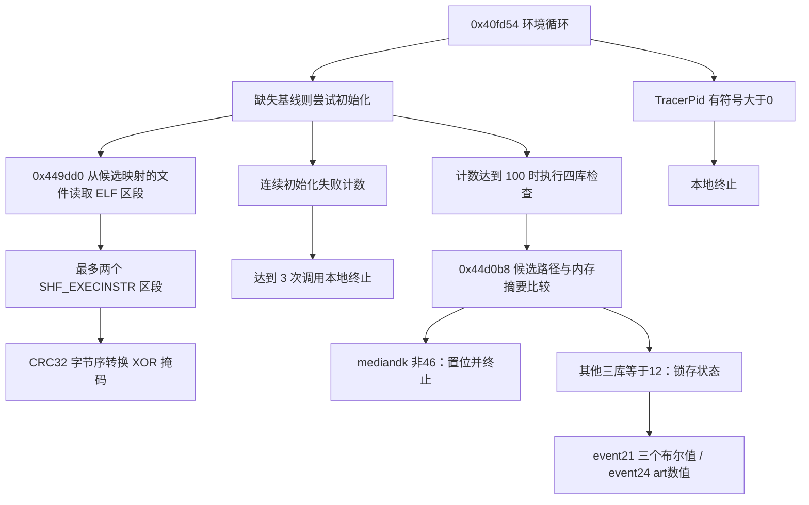

# PrismSUN 环境、内存完整性与输入法专项

日期：2026-10-16。续接会话：`01a14039-f500-7131-9dd3-a596b6eb2498`。

本次续接只使用 IDA Pro MCP 分析样本，没有使用 REA 插件，没有启动子代理。历史原指令测试记录直接复用；本次新运行的是重建代码的编译、宿主测试和保存结果比对，没有重新执行原样本、仿真器或 Android 游戏客户端。

## 结论与覆盖范围

可以将本地链路明确拆成四部分：函数入口指令自检；四个系统库的文件基线与进程映射摘要比较；TracerPid、seccomp/SIGSYS 等环境观察；JNI 类、无障碍服务和输入法的枚举与结果生成。它们的检测对象、失败处理和事件含义不同，不能统一命名为“Xposed 检测”。

本次补齐了四库基线、比较器主要分支、环境循环和输入法链路的源码与报告，修正了中断时草稿中的映射基址选择错误。**输入法实际使用 `getInputMethodList()` 枚举系统可返回的输入法，再读取 `getServiceName()`；已追踪的链路没有读取“当前默认输入法”的证据。** 已有无障碍链读取的是已启用无障碍服务 ID。两类信息可以包含与按键映射软件有关的服务，但当前证据没有证明 KeyMapper 专用匹配或联合处罚规则。

交付是可编译的语义重建子集，不能代替原反作弊库。尚未闭合的关键点包括：maps 两个混淆过滤器的完整语义、seccomp 原因码的全部来源分支、事件 22 的运行时类名单、真实宿主传输和服务端裁决。后文保留明确边界，不将这些问题写成已完成。

## 样本与证据

原始 ELF：`D:/PrismSUN/libprism-sun.so`，SHA-256：

`92e7d4adda7e222aa9dce389009a186adabb2602b80d618d417e0f6d509adaf4`

续接数据库为本目录 `prism-environment-memory.i64`。本轮按已有 ELF/FDE 清单恢复了六个函数边界：`0x44a5c0..0x44aa00`、`0x5f917c..0x5fb6ac`、`0x5fb6b0..0x5fdbe0`、`0x5cd914..0x5cdc88`、`0x5ce9c0..0x5cee84`、`0x44b0f4..0x44b670`，已保存数据库。打开时 Hex-Rays 可用，但全局自动分析就绪标志为 false；不据此宣称整个 IDB 已分析完整。新导出位于 [证据索引](evidence/INDEX.md)。

证据分三种：本轮直接从 IDA 导出的带地址伪代码/汇编；旧研究保留的调用端字符串解码与原指令测试；新 C++ 的宿主测试。后三者中的不同范围不会混算成“全链路原件差分”。`rea-evidence-2026-10-16.json` 是旧会话残留，本轮未调用 REA，也未用它作为新增结论的独立依据。

## 四库完整性链路

### 基线从哪里来

`0x449dd0` 首先调用 `0x5cc630(name, 1)` 取得候选映射，寻找路径以 `/` 开头的记录，再打开这个路径。它从文件读取 64 字节 ELF 头，使用头部 `e_shoff` 与 `e_shnum`，按 64 字节区段头顺序读取；遇到 `sh_flags & 4` 即记录该区段的 `sh_offset`、`sh_size`，最多两个。这是 **section header** 路径，不是遍历 `PT_LOAD`，也不是读取全库所有字节。

随后它逐个 seek/read 区段文件字节，调用 `0x44c740`，与同一基线内的 32 位掩码 XOR 后保存。只有完成初始化路径才写入有效标志。相关证据：[基线构造](evidence/ida-0x449dd0.json)、[路径首字节比较汇编](evidence/ida-path-test-asm.json)。

| 相对基线偏移 | 内容 |
| --- | --- |
| +0 | 记录数量，通常 1 或 2 |
| +8 / +16 | 两个文件区段偏移 |
| +24 / +32 | 两个区段长度 |
| +40 / +44 | 摘要 XOR 掩码 |
| +48 | 32 位掩码 |
| +56 | 可跨调用保留的备用映射基址 |
| +64 | 初始化完成标志低位 |

掩码入口 `0x4572c8 -> 0x44c594` 创建局部状态并取得 4 字节；其随机性、熵强度不在本次结论内。XOR 仅改变存储形式，没有将 CRC32 变成密码学认证。

旧会话的 [摘要原指令记录](evidence/digest-differential.json) 有 6/6 个例，覆盖空串、短串、已知向量、零字节等。返回值与 `bswap32(IEEE CRC32(data))` 相同：Botan 输出大端 CRC 字节，调用方按 ARM64 小端 u32 使用。本轮重建代码逐项比对这些已保存返回值。此摘要与 APK 专项中的 SHA-256 是不同路径。

宿主演示还用当前原始 ELF 生成离线基线；这只验证解析/哈希输出，并不表示该样本就是四库循环的目标库，更不是游戏进程现场结果。

### 映射比较器的真实分支

[`0x44d0b8` 伪代码](evidence/ida-0x44d0b8.json) 与 [汇编](evidence/ida-maps-asm.json) 支持以下顺序：

1. 基线 +64 低位未置位时返回 23。
2. `0x5cc630(name, 1)` 返回空向量时返回 57。`0x457318 -> 0x44a5c0` 比较 begin/end，实际是 vector empty。**57 不能仅解释为文件打开失败**；没有匹配记录、全部记录被过滤或解析失败也可使向量为空。
3. 遍历候选记录。上一个路径非空且当前路径不相等时，先调用 `0x4c3778` 本地终止路径，随后有设置返回码 12 的代码。终止调用的真实副作用不能被简化为一个普通的 false。
4. 更新上一个路径，再检查权限。路径一致性检查先于可读性检查。
5. 不可读映射跳过；可读但不可执行映射把起始地址写入基线 +56，继续遍历。
6. 遇到首个可读、可执行映射时，先选 `map.start` 为整次比较的基址。只要任一区段满足 `map.start + offset + size > map.end` 且 +56 非零，改用 +56，并清零 +56；**同一个基址用于所有区段**。
7. 依次摘要 `base + section.file_offset` 开始的区段字节，与期望值比较。不一致返回 12；全部一致返回 46，并立即结束，不再检查后续可执行映射。
8. 非空候选向量遍历完却没有进行可执行映射摘要比较，也可返回 46。因此 46 的精确含义是该函数在此分支正常结束，不能泛化为“全部内存已验证”。

另一个容易被“安全化重写”改变的细节：没有 +56 备用基址时，即使区段范围超过当前 `map.end`，原函数仍继续按当前基址尝试读取，并没有跳过该区段；地址计算使用 64 位回绕加法，也没有减去 maps 的文件 offset。重建通过可注入 `MemoryReader` 表达读取请求，不直接解引用任意宿主地址。读取失败时返回 `complete=false, code=nullopt`，这是宿主模型边界，不伪造样本的 23/12/46/57 返回码。

### maps 采集的已知与未知

[`0x5cc630`](evidence/ida-0x5cc630.json) 通过文件读取、getline、七项格式转换生成记录；权限字符 r/w/x 分别映射到 1/2/4，路径前导空白被跳过。记录含起止地址、权限、private 标记、文件偏移、设备/inode 和路径。

它还调用 `0x5fb6ac -> 0x5f917c` 与 `0x5fdbe0 -> 0x5fb6b0` 进行两个过滤测试。新恢复的这两个函数仍高度平坦化，局部变量存在明显栈别名/反编译失真；本报告不擅自将它们命名成已证明的 strstr、后缀检查或 deleted 过滤器。原 getline 路径还会将最后一个已读字节置零，不能直接当成具有完善末行处理的通用文本解析器。

因此源码 `parse_maps_text()` 只提供格式解析；`compare_mappings()` 要求调用方提供**已过滤、保持原顺序**的候选记录。把所有进程映射直接传进去可能触发路径不同分支，不能作为真实扫描器使用。

### 四个库的处置不同

| 库 | 单例中的基线 | 锁存状态 | 比较条件与后续 |
| --- | --- | --- | --- |
| libmediandk.so | +480 | +217 | `0x410408` 比较 46；任何非46结果置位并调用终止 |
| libc.so | +264 | +216 | `0x4104c8` 比较 12；命中后置位 |
| libandroid.so | +408 | +219 | `0x410584` 比较 12；命中后置位 |
| libart.so | +336 | +218 | `0x410640` 比较 12；命中后置位 |

后三库已经置位时在当前循环中跳过相应检查，未见此循环清除锁存位。源自 [`environment_asm_256.json`](../evidence/environment_asm_256.json) 与 [`environment_asm_512.json`](../evidence/environment_asm_512.json)；库名来自 [调用端解码证据](evidence/inherited-string-evidence.json)。

初始完整性计数为 100，使用无符号 `>=100` 检查；完整一轮后归零，普通循环末尾自增。所以从首次检查后的计数 1 开始，有 99 次不执行完整性扫描的普通周期，然后再次执行。初始化失败走单独计数，连续三次调用本地终止，成功会清零失败计数。这里的计数单位是循环，不能写成 100 秒。草稿中的 `precheck_failed` 对应本轮所需基线尚未初始化成功；完整线程的锁、休眠和异常展开没有移植进模型。

## TracerPid、seccomp 与自身指令检查

`0x40fd54` 在合适分支调用 `0x406068` 获取 TracerPid，`0x4106f8` 的 CMP 与 `0x4106fc` 的有符号 B.LE 证明只有有符号值大于零进入阳性路径。`0x4497e0 -> 0x4c3778` 链含 getpid/gettid、tgkill(signal 9)、exit_group(2) 和后续 BRK。重建只输出 `local_termination`，不在宿主执行终止系统调用。证据与原判定测试见 [既有主报告](../REPORT.zh-CN.md)、[终止汇编](../evidence/0x4c3778_asm_0.json)。

`0x47df58` 聚合 seccomp 状态、过滤器计数、layer 参数与 SIGSYS handler 来源。它保留 32 位 layer+1 回绕，再做有符号比较；原因码 byte 小于 10 为可接受。状态获取失败会使 acceptable=false；handler 获取失败不等同于 handler 被判定可疑。已有 `observed_models.cpp` 的聚合模型及 704 个原指令 fixture 结果直接复用。新导出 [聚合器](evidence/ida-0x47df58.json) 与 [原因码生产者](evidence/ida-0x471c8c.json)；后者仍含 JUMPOUT 与失真的栈变量，尚不能给出每个原因码的完整命名表。

多个函数检查自身入口的 B/BRK/BR 指令特征，命中可进入 abort。这是有限模式检查，不能推导为识别任何 Hook。TLS 中 `TPIDR_EL0+40` 的栈保护读写也不能单独作为反调试证据。

## 输入法、无障碍与 KeyMapper

输入法路径为：JNI 环境取得 → ActivityThread/currentActivityThread/getApplication → Context.INPUT_METHOD_SERVICE → getSystemService → InputMethodManager.getInputMethodList → List.size/get → InputMethodInfo.getServiceName → GetStringUTFChars 的 modified UTF-8 字节。

证据为 [`0x34adcc`](evidence/ida-0x34adcc.json)、[调用端解码](evidence/inherited-string-evidence.json)；它没有使用当前输入法 ID、Settings.Secure.DEFAULT_INPUT_METHOD 或 getEnabledInputMethodList 的已追踪调用。这里的否定只限于此条已追踪链路，不排除其他未分析代码读取这些数据。

消费者 [`0x6f4218`](evidence/ida-0x6f4218.json) 将服务名按原列表顺序加入 JSON 数组，再对副本排序。`0x6f8da4` 对排序后各字符串依次追加一个 NUL，计算 CRC32，再转成上述字节序。既有 [9 个原指令结果](evidence/ime-hash-differential.json) 覆盖重排、重复、长短字符串、高位字节和合成嵌入 NUL。本轮新 C++ 对保存结果逐项一致。JNI 真实字符串使用 modified UTF-8；测试中合成原始 NUL 的字节哈希不代表 JSON 字符串路径也保留同样长度。

| 状态/情况 | 输出与状态变化 |
| --- | --- |
| 单例 +564 未初始化 | 保存 +560 哈希，置 +564，event 34 |
| 已初始化且哈希不同 | 更新 +560，event 35 |
| 哈希相同 | kind 1，无新事件；仅重排列也会如此 |
| JNI 环境不可得 | kind 2 / 0xBBA 诊断，哈希与首次状态不更新 |

首次空列表仍可产生 event 34。哈希不是集合去重，重复项保留；也不是无碰撞的全量比较。新 JNI 适配器保留原列表顺序，并把异常和空依赖标注为未完成；这些显式保护是适配器增强，不声称与原件每个异常分支一致。返回 `complete=false` 的部分列表不能送入变化检测器充当完整快照。

无障碍专项已经证明 `getEnabledAccessibilityServiceList(-1) -> getId()`，首次/变化事件是 25/33。详情见 [无障碍报告](../accessibility/REPORT.zh-CN.md)。输入法采集和无障碍采集两条链都有独立状态，当前没有证明它们在本地做 KeyMapper 专用交集、名称匹配或作弊裁决。IDA 已识别字符串的有界检索零命中，记录见 [搜索边界](evidence/ida-bounded-string-search.json)；加密字符串、动态配置与远端规则不受这个零命中结论覆盖。

## Xposed、客户端完整性与结果去向

事件 22 的 [`0x6ab3d8`](evidence/ida-0x6ab3d8.json) 消费调用方给出的配置列表，逐项 FindClass，查询异常则 ExceptionClear 并继续；无异常且类引用非空则 DeleteLocalRef 并保留原配置项。`0x6b695c -> 0x6ae288` 对列表有效性/非空条件做门控，`0x6b0998` 返回持有的对象指针。**本地存在通用类可见性探测，具体是不是探测 Xposed 类取决于实际名单；本轮没有取得实际运行时配置。** 既有 404 个有界测试复用，不能把它改名为 404 次 Xposed 检出。

四库内存检查直接证明的是 libmediandk/libc/libandroid/libart 的区段内容和路径一致性。`libminecraftpe.so` 字符串与相关代码线索，不足以证明该比较器给整个游戏库或整个 APK 做官方可信基线验证。APK v2 块相关摘要、设备信息及 event19 的更完整研究见 [设备身份专项](../device_identity/REPORT.zh-CN.md)，不要把摘要采集与验证 APK 官方签名混为一谈。

本轮确认状态到结果的如下边界：

| 事件 | 本地生产者与内容 | 证据 |
| --- | --- | --- |
| 20 | `0x650898` 读取状态+20/+24与集合；业务字段仍部分未知 | [导出](evidence/ida-0x650898.json) |
| 21 | `0x66e838` 按 libart、libandroid、libc 顺序输出三个布尔值 | [导出](evidence/ida-0x66e838.json) |
| 22 | 配置中的可见类项 | [导出](evidence/ida-0x6ab3d8.json) |
| 24 | `0x68cbe0` 将 libart 锁存位转为数值0/1 | [导出](evidence/ida-0x68cbe0.json) |
| 34/35 | 输入法原序服务名数组的首次/变化结果 | [导出](evidence/ida-0x6f4218.json) |

它们进入 `0x634e84` 结果对象构造；事件编号保存在对象+4、载荷在+8。已有设备身份专项在有界 fixture 中把 event19 串到紧凑 JSON、AES256-GCM packet 和输出共享区，但这不自动证明本轮所有事件都已逐个完成同样的端到端回放，更不证明真实网络上传、服务端合并或处罚。

## 对规避假设的可验证评估

下表回答“可能的绕过方案”在当前证据下能讨论到的范围。它们是需要对照实验的假设，未交付已验证可用的绕过补丁；也不据此宣称当前样本可以被稳定规避。

| 假设/方向 | 本地证据支持的评估 | 尚需验证 |
| --- | --- | --- |
| 仅改变当前默认输入法 | 已观察路径枚举整个输入法列表，默认项切换可能完全不改变所采集数组 | 同一安装/启用状态下切换默认项，比较event34/35 |
| 只控制输入法枚举结果 | 最多影响该项采集；无障碍、类查询、系统库完整性和环境链仍独立存在 | 对所有相关事件作一致性观测，不能只看一个API返回值 |
| 同时改变文件基线与内存 | 基线来自候选路径文件，CRC32也不验证官方签名；说明本分支的信任边界依赖基线来源 | 基线初始化时机、其他检查、实际文件权限与签名链 |
| 利用未覆盖区段/后续映射 | 最多两段、首个可执行候选提前返回及无可执行候选返回46是覆盖边界 | 两个过滤器、进程实际布局、其他调用是否补充检查 |
| 仅拦截一个libc API | 已有 syscall 包装及独立入口自检，无法据此推断全链路被覆盖 | 每条读取来源、实际 syscall/PLT 路径与跨项数据一致性 |
| 以CRC32碰撞隐藏差异 | CRC32非密码学认证是数学性质，但跨库、入口自检和其他事件不会因此自动失效 | 真实比较范围、其他可信信号以及稳定性 |

不以“事件未变化”推断“未检测”，也不以“客户端未退出”推断“服务器接受”。本地作用、协议交付和服务端决策需要分别观察。

## 源码、验证与剩余工作

源码入口：[environment_memory.hpp](src/environment_memory.hpp)、[实现](src/environment_memory.cpp)、[JNI适配器](src/input_methods_jni.cpp)。已整合既有 `observed_models.cpp` 与 `class_probe_model.cpp`，并复用此前验证过的 JNI environment scope。构建与边界见 [README](README.md)。

本轮最终宿主模型测试 73 项通过（含 15 项保存原指令结果比对），JNI mock 8 场景通过。Windows EXE/DLL 和 Android ARM64/API24 executable/SO 实际编译。JNI mock检查方法签名、列表顺序、引用释放、UTF资源和待处理异常；不模拟真实Android权限、类加载器、系统服务或厂商行为。没有本轮新增的完整比较器原指令差分、真机、线程竞争或异常展开等价证明。

原始ELF、根目录i64、`prism-analysis.i64` 和旧inspect副本的本轮前后哈希见 [before](evidence/resume-before.json)、[verification](evidence/verification.json)。这些是本轮保护范围，不能替旧会话声称根目录i64从项目最初至今从未变化。

下一步可直接从以下证据缺口继续，无需重新运行已经完成的旧套件：

1. 基于已恢复函数边界，化简 `0x5f917c` / `0x5fb6b0` 的实际过滤语义与字符串来源；补真实候选列表到比较器的闭环。
2. 恢复 `0x471c8c` 中目前 JUMPOUT/坏栈的分支，逐个解释原因码，追踪全部 seccomp 消费者。
3. 从调用 `0x6ab3d8` 的配置持有者取得真实配置来源及名单，才能验证 Xposed 专用检测假设。
4. 在授权Android现场对默认输入法、安装列表、无障碍服务作单变量实验；目前没有设备或运行时捕获输入。
5. 将本轮事件21/22/24/34/35分别接到既有结果转换/共享区fixture，并核实真实宿主和服务端边界。

因此，本次可交付“基线/比较器/状态/输入法的可编译研究实现与可追溯报告”，不能交付“整个ACE已完整还原”或“稳定绕过已证实”的结论。
